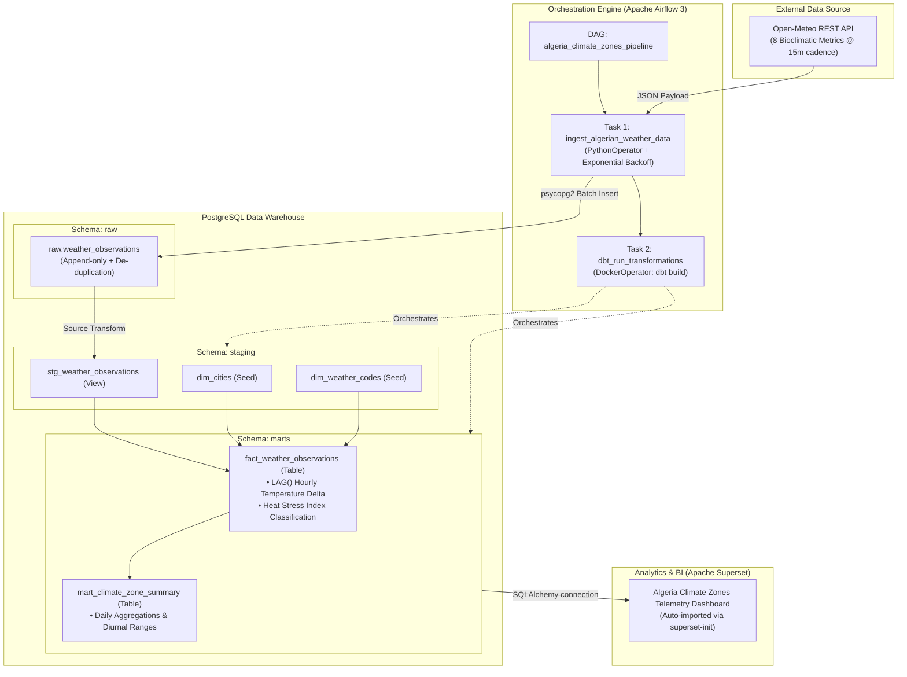
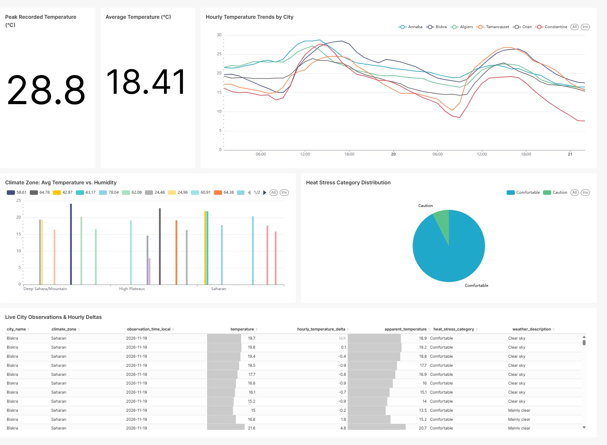

# Algerian Climate Zones: Real-Time Weather & Bioclimatic Data Pipeline

**Author:** [Mohamed Amine Ghezal](https://github.com/amineghezal)  
**Role:** Data Engineer  
**Tech Stack:** Python 3.10+, Open-Meteo REST API, Apache Airflow 3.0, dbt Core 1.9, PostgreSQL 14, Apache Superset 3.0, Docker & Docker Compose

---

## 1. Project Overview & Problem Statement

Algeria spans across more than 2.38 million square kilometers, encompassing extraordinary bioclimatic contrasts: from lush, humid Mediterranean coastal plains and elevation-influenced semi-continental plateaus to hyper-arid Saharan ergs and high-altitude desert massifs. 

Standard aggregate weather feeds mask extreme microclimatic divergence. Rapid temperature drops in the High Plateaus, desert diurnal swings exceeding 20°C, and dangerous coastal apparent heat stress require granular, continuous telemetry.

This project delivers an end-to-end, production-grade **Data Engineering Pipeline** that ingests, models, validates, and serves real-time and historical bioclimatic observations for **6 representative Algerian cities across distinct climate zones**:

| Wilaya Code | City | Wilaya | Climate Zone | Elevation | Geographical & Climatic Profile |
|:---:|:---|:---|:---|:---:|:---|
| **07** | **Biskra** | Biskra | **Saharan (Arid)** | 87 m | Low-altitude northern Saharan gateway; extreme summer heat and low humidity. |
| **16** | **Algiers** | Alger | **Mediterranean Coastal** | 10 m | Temperate coastal capital; marine boundary layer, humid sea breezes, winter rains. |
| **31** | **Oran** | Oran | **Western Coastal** | 60 m | Semi-arid coastal climate; maritime airflow with lower annual rainfall than the east. |
| **25** | **Constantine** | Constantine | **High Plateaus** | 694 m | Continental highland gorge; colder winters, elevated diurnal swings. |
| **11** | **Tamanrasset** | Tamanrasset | **Deep Sahara / Mountain** | 1,370 m | Hyper-arid Ahaggar volcanic plateau; intense solar radiation and high elevation. |
| **23** | **Annaba** | Annaba | **Eastern Coastal** | 3 m | Humid maritime basin; higher precipitation and pronounced thermal inertia. |

---

## 2. End-to-End Architecture



---

## 3. Data Warehouse Modeling: Dimensional Star Schema

The data warehouse enforces a clean separation of concerns across three PostgreSQL schemas: `raw`, `staging`, and `marts`.

```
                    ┌────────────────────────────┐
                    │      dim_cities (Seed)     │
                    ├────────────────────────────┤
                    │ PK  city_id                │
                    │     name                   │
                    │     wilaya                 │
                    │     climate_zone           │
                    │     latitude, longitude    │
                    │     elevation_m            │
                    └─────────────┬──────────────┘
                                  │ 1
                                  │
                                  │ N
┌────────────────────────────┐    │    ┌─────────────────────────────┐
│ dim_weather_codes (Seed)   │    │    │ fact_weather_observations   │
├────────────────────────────┤    │    ├─────────────────────────────┤
│ PK  weather_code           ├────┼───►│ PK  observation_id          │
│     weather_description    │ 1  │ N  │ FK  city_id                 │
│     weather_category       │    │    │ FK  weather_code            │
└────────────────────────────┘    │    │     temperature             │
                                  │    │     prev_hourly_temp        │
                                  │    │     hourly_temp_delta       │
                                  │    │     apparent_temperature    │
                                  │    │     relative_humidity       │
                                  │    │     surface_pressure        │
                                  │    │     wind_speed              │
                                  │    │     uv_index                │
                                  │    │     precipitation           │
                                  │    │     heat_stress_category    │
                                  │    │     observation_time_local  │
                                  │    └──────────────┬──────────────┘
                                  │                   │
                                  └────────┐          │ aggregates
                                           │          ▼
                                  ┌────────┴─────────────────────────┐
                                  │ mart_climate_zone_summary        │
                                  ├──────────────────────────────────┤
                                  │ PK  climate_zone, city_name,     │
                                  │     observation_date             │
                                  │     total_observations           │
                                  │     avg_temp, min_temp, max_temp │
                                  │     diurnal_temperature_range    │
                                  │     avg_apparent_temp            │
                                  │     avg_relative_humidity        │
                                  │     max_wind_speed, max_uv_index │
                                  │     high_heat_stress_hours       │
                                  └──────────────────────────────────┘
```

### Table Definitions

1. **`staging.dim_cities` (Seed Dimension)**:
   Reference data capturing the 6 wilayas, official geographical coordinates, elevation, and assigned bioclimatic zones.
2. **`staging.dim_weather_codes` (Seed Dimension)**:
   Standard World Meteorological Organization (WMO) code lookup table providing descriptions (e.g., *Clear sky*, *Dense drizzle*, *Thunderstorm with hail*) and high-level weather groupings.
3. **`staging.stg_weather_observations` (Staging View)**:
   Extracts from `raw.weather_observations`, handles deduplication with `ROW_NUMBER() OVER (PARTITION BY city_name, observation_time ORDER BY inserted_at DESC)`, standardizes timestamp timezone adjustments (`observation_time_local`), and casts numerical metrics.
4. **`marts.fact_weather_observations` (Core Fact Table)**:
   Materialized as a physical table to allow unconstrained window calculations. Joins dimensional attributes and calculates analytical features.
5. **`marts.mart_climate_zone_summary` (Aggregated Data Mart)**:
   Rollup by `climate_zone`, `wilaya`, `city_name`, and `observation_date` calculating diurnal ranges, average humidity, peak UV index, and cumulative heat stress exposure hours.

---

## 4. Feature Engineering: Bioclimatic Metrics

### 1. Hourly Temperature Delta (`LAG()` Window Function)
Quantifies rapid thermal shifts (such as coastal sea breezes or desert night cooling) across consecutive hourly observations:
```sql
LAG(temperature, 1) OVER (
    PARTITION BY city_id 
    ORDER BY observation_time_local
) AS prev_hourly_temperature,

ROUND((temperature - LAG(temperature, 1) OVER (
    PARTITION BY city_id 
    ORDER BY observation_time_local
))::numeric, 2) AS hourly_temperature_delta
```

### 2. Bioclimatic Heat Stress Index
Combines dry-bulb temperature and relative humidity to assess human physiological thermal strain:
```sql
CASE 
    WHEN apparent_temperature >= 41.0 OR (temperature >= 38.0 AND relative_humidity >= 40.0) 
        THEN 'Extreme Danger'
    WHEN apparent_temperature >= 35.0 OR (temperature >= 33.0 AND relative_humidity >= 45.0) 
        THEN 'Danger'
    WHEN apparent_temperature >= 29.0 OR (temperature >= 28.0 AND relative_humidity >= 50.0) 
        THEN 'Extreme Caution'
    WHEN apparent_temperature >= 24.0 
        THEN 'Caution'
    WHEN apparent_temperature < 5.0 
        THEN 'Cold Stress'
    ELSE 'Comfortable'
END AS heat_stress_category
```

---

## 5. Data Quality, Reliability & Orchestration

### Automated dbt Schema Testing Strategy
All models undergo rigorous validation during every pipeline run using `dbt build`:

- **Entity Integrity**: `unique` and `not_null` assertions on all surrogate and natural primary keys (`city_id`, `weather_code`, `observation_id`).
- **Referential Integrity**: `relationships` tests enforcing that every observation references a valid `dim_cities.city_id` and `dim_weather_codes.weather_code`.
- **Domain Constraints**: `accepted_values` verification on `climate_zone` (the 6 designated Algerian zones) and `heat_stress_category`.
- **Completeness**: `not_null` assertions on critical telemetry fields (`temperature`, `relative_humidity`, `observation_time_local`).

### Resilient Airflow DAG Cadence
The orchestration DAG `algeria_climate_zones_pipeline` runs on a **15-minute schedule** designed for high availability:
- **Exponential Backoff**: Configured with `retries: 3`, `retry_delay: 2 minutes`, and `retry_exponential_backoff: True` up to a 10-minute ceiling to absorb transient API network timeouts.
- **Atomic Execution**: Python ingestion validates schema availability and commits observations in bulk; upon completion, a `DockerOperator` executes `dbt build`, simultaneously executing models and tests.

---

## 6. Telemetry & Analytics Dashboard (Apache Superset)

The project includes an exported, version-controlled Superset dashboard located at `docker/dashboard/algeria_climate_dashboard.zip`, automatically imported on startup by the `superset-init` container.



### Key Analytical Views:
- **Real-Time KPIs**: Current average temperature, highest regional temperature, and active weather condition distribution.
- **Hourly Temperature Trends**: Comparative multiline chart contrasting the coastal thermal stability of Algiers and Annaba against the extreme diurnal swings of Biskra and Tamanrasset.
- **Thermal Heat Stress Breakdown**: Distribution of hours spent across *Danger*, *Extreme Caution*, and *Comfortable* zones by Wilaya.
- **Telemetry Drill-Down Table**: Live observation feed displaying hourly temperature deltas and barometric pressure trends.

---

## 7. Local Setup & Reproduction

### Prerequisites
- [Docker](https://docs.docker.com/get-docker/) & [Docker Compose v2+](https://docs.docker.com/compose/)
- At least 4 GB of available system memory

### 1. Clone & Start the Stack
```bash
# Clone the repository
git clone https://github.com/amineghezal/Real-time-weather.git
cd Real-time-weather

# Build and start all services in detached mode
docker compose up -d --build
```

### 2. Verify Container Health
```bash
docker compose ps
```
You should see:
- `algeria_postgres_db` (Up, Healthy on port `5000:5432`)
- `algeria_redis` (Up on port `6379`)
- `algeria_airflow` (Up on port `8000:8080`)
- `algeria_superset` (Up, Healthy on port `8088:8088`)
- `algeria_weather_init` & `algeria_dbt` (Exited with code 0 after successful execution)

### 3. Verify PostgreSQL Data Warehouse
Inspect the materialized fact table directly via `psql`:
```bash
docker exec -it algeria_postgres_db psql -U db_user -d db -c "
SELECT 
    city_name,
    climate_zone,
    observation_time_local,
    temperature,
    hourly_temperature_delta,
    heat_stress_category,
    weather_description
FROM marts.fact_weather_observations
ORDER BY observation_time_local DESC, city_name
LIMIT 12;
"
```

### 4. Access Web Interfaces
- **Apache Superset Dashboard**: [http://localhost:8088](http://localhost:8088)  
  *Credentials:* `admin` / `admin`  
  *Dashboard:* **Algeria Climate Zones - Live Telemetry**
- **Apache Airflow Orchestrator**: [http://localhost:8000](http://localhost:8000)  
  *DAG:* `algeria_climate_zones_pipeline`

---

## 8. Repository Structure

```
.
├── .gitattributes                  # Enforces LF endings on shell scripts across OS environments
├── docker-compose.yml              # Multi-container orchestration definition
├── README.md                       # Project documentation & portfolio overview
├── requirements.txt                # Root Python dependencies
│
├── airflow/
│   └── dags/
│       └── orchestrator.py         # Airflow DAG orchestrating ingestion & dbt build
│
├── dbt/
│   ├── profiles.yml                # PostgreSQL connection profile for dbt
│   └── my_project/
│       ├── dbt_project.yml         # dbt project configurations & schema definitions
│       ├── macros/
│       │   └── generate_schema_name.sql  # Custom schema routing macro (raw, staging, marts)
│       ├── models/
│       │   ├── schema.yml          # dbt data quality test assertions (FKs, unique, not_null)
│       │   ├── mart/
│       │   │   ├── fact_weather_observations.sql # Core fact table with LAG delta & Heat Stress
│       │   │   └── mart_climate_zone_summary.sql # Aggregate climate zone analytical mart
│       │   ├── sources/
│       │   │   └── sources.yml     # Source declaration for raw.weather_observations
│       │   └── staging/
│       │       └── stg_weather_observations.sql  # Cleaned, deduplicated staging view
│       └── seeds/
│           ├── dim_cities.csv      # Seed data: 6 Algerian cities, coordinates, elevation
│           ├── dim_weather_codes.csv # Seed data: WMO weather code dictionary
│           └── schema.yml          # Seed schema integrity tests
│
├── docker/
│   ├── dashboard/
│   │   └── algeria_climate_dashboard.zip # Pre-configured Superset dashboard export
│   ├── docker-bootstrap.sh         # Superset environment bootstrap script
│   ├── docker-init.sh              # Superset initialization pipeline
│   ├── import_dashboard.py         # Automated database setup & dashboard import script
│   ├── superset_config.py          # Superset application & caching configuration
│   └── sync_dashboard.py           # Dashboard synchronization utility
│
├── docs/
│   └── images/
│       └── superset_dashboard.jpg  # Dashboard screenshot preview
│
├── postgres/
│   ├── airflow_init.sql            # Airflow database user & db initialization
│   ├── init_schemas.sql            # Pre-creates raw, staging, and marts schemas
│   └── superset_init.sql           # Superset database user & db initialization
│
└── scripts/
    ├── api_request.py              # Open-Meteo REST API client with retry backoff
    ├── insert_records.py           # Real-time incremental observation ingestion
    └── seed_weather.py             # Historical weather seed ingestion script
```
